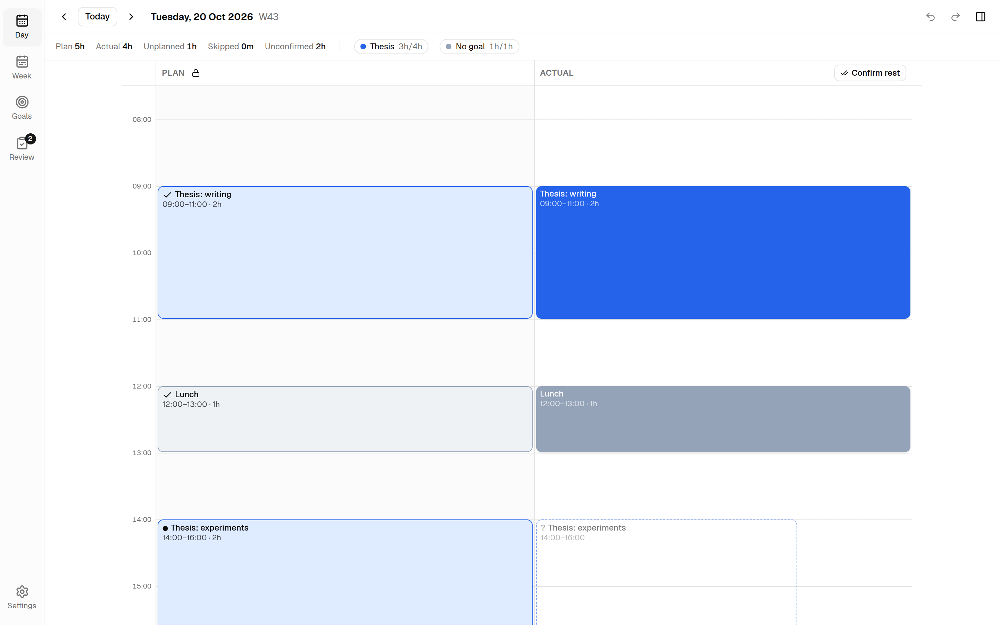
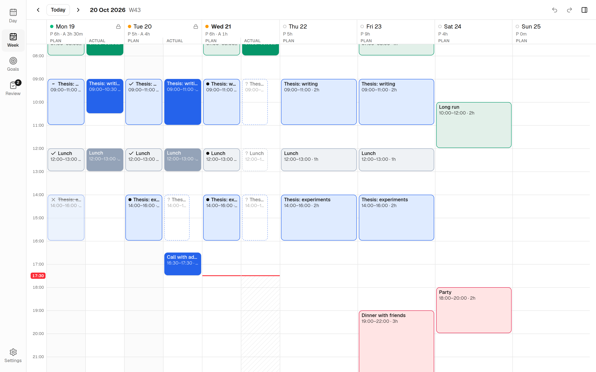
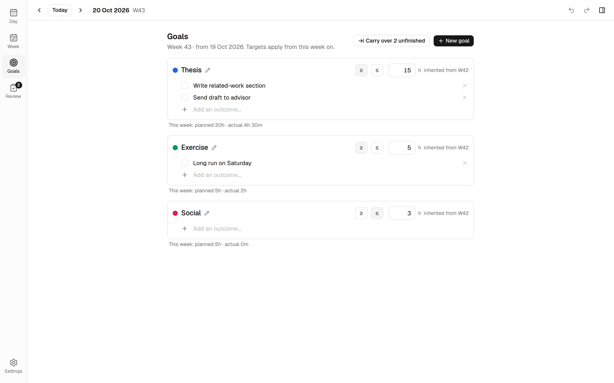
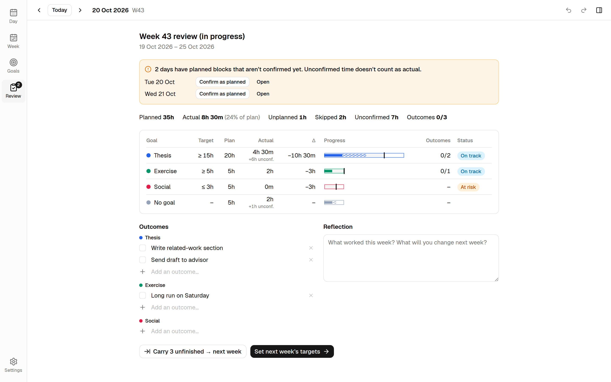

<div align="center">


# Timeblock

**Plan your day. Log what really happened. See how it stacks up against your weekly goals.**

[](../../releases)
[](LICENSE)


[Download](../../releases) · [Features](#features) · [Shortcuts](#keyboard-shortcuts) · [Development](#development) · [Changelog](CHANGELOG.md)

<br>

<picture>
  <source media="(prefers-color-scheme: dark)" srcset="site/assets/screenshots/day-dark.png">
  
</picture>

</div>

<br>

Timeblock is a **local-first desktop app**. Your data is a SQLite file on your machine:
no account, no server, no telemetry.

## Features

| | |
|---|---|
| 🗓️ **Plan \| Actual day view** | Drag to create, move and resize blocks. `Shift` snaps to 5 minutes, `Ctrl` copies. Overlapping blocks sit side by side. |
| 👻 **Ghosts** | Every plan block shows up dashed in the Actual lane until you confirm it (`a`) or skip it (`s`). Drag a ghost to log it at a different time. *Confirm rest of day* (`Shift+A`) logs every past ghost around whatever you already logged. Unconfirmed time never counts as actual, so your numbers stay honest. |
| 📅 **Week view** | Plan \| Actual split for past days; drag blocks across days. |
| 🎯 **Goals** | Weekly targets, either *at least* (Thesis ≥ 15 h) or *at most* (Social ≤ 3 h), measured by time or by tasks done. Targets carry forward until you change them; past weeks never change. Each goal has a weekly outcome checklist with carry-over. |
| 📊 **Budget and review** | A week budget panel (`Ctrl+B`) and a weekly review: target vs plan vs actual, status per goal, outcomes and a reflection note. |
| 📈 **Trends** | Planned vs actual per goal over 4, 12 or 26 weeks, streaks, and plan-accuracy stats (`i`). |
| 🛟 **Safe by default** | Undo/redo for everything, command palette (`Ctrl+K`), daily automatic backups, JSON export/import. |

<details>
<summary><b>More screenshots</b></summary>

<br>

<picture>
  <source media="(prefers-color-scheme: dark)" srcset="site/assets/screenshots/week-dark.png">
  
</picture>

<picture>
  <source media="(prefers-color-scheme: dark)" srcset="site/assets/screenshots/goals-dark.png">
  
</picture>

<picture>
  <source media="(prefers-color-scheme: dark)" srcset="site/assets/screenshots/review-dark.png">
  
</picture>

</details>

### Keyboard shortcuts

| Keys | Action |
|---|---|
| `d` `w` `g` `r` `i` | Day, Week, Goals, Review, Trends |
| `t`, `[`, `]` | Today, previous, next |
| `Ctrl+K` | Command palette |
| `Ctrl+Z` / `Ctrl+Shift+Z` | Undo / redo |
| `Ctrl+B` | Week budget panel |
| `Enter` | Edit the selected block |
| `Delete` | Delete the selected block (skips a ghost) |
| `↑` `↓` / `Shift+↑` `Shift+↓` | Nudge / resize the selected block |
| `1`–`9` | Set the selected block's goal |
| `a` / `s` | Confirm / skip the selected plan block or ghost |
| `Shift+A` | Confirm the rest of the day as planned |
| `Esc` | Cancel a drag, close the editor, clear the selection |
| `?` | Show all shortcuts |

## Install

Download the file for your system from the [Releases](../../releases) page. Builds are
not code-signed yet.

- **Linux:** `.rpm` (Fedora), `.deb` (Debian/Ubuntu) or `.AppImage`. The AppImage needs
  glibc 2.39 or newer (Fedora 40+, Ubuntu 24.04+); use the `.rpm`/`.deb` on older systems.
- **macOS:** open the `.dmg` and drag Timeblock to Applications. The first launch is
  blocked because the app isn't notarized: open *System Settings → Privacy & Security*
  and click **Open Anyway**.
- **Windows:** run the `.msi` or `-setup.exe`. If SmartScreen warns about an
  unrecognized app, click **More info → Run anyway**.

Only one copy of Timeblock runs at a time: launching it again brings the open window to
the front.

### Updates

From 0.2.0 on, Timeblock looks for a new release on launch and once a day (turn this off in
*Settings → Updates*). Nothing installs until you click **Install and restart**: your data is
backed up first, and the update is checked against Timeblock's signing key before it runs.
All install types update in place. On Linux, `.deb` and `.rpm` installs ask for your system
password, the same as installing the package by hand. Version 0.1.0 has no updater, so
download 0.2.0 from Releases once.

## Your data and backups

| OS | Folder |
|---|---|
| Linux | `~/.local/share/com.shreysingh.timeblock/` |
| macOS | `~/Library/Application Support/com.shreysingh.timeblock/` |
| Windows | `%APPDATA%\com.shreysingh.timeblock\` |

- `data.sqlite3` holds everything. *Settings → Open data folder* opens it.
- `backups/` gets a copy at most once a day, before every import and before schema
  upgrades; the newest 14 are kept. To restore one, quit Timeblock and copy it over
  `data.sqlite3`.
- *Settings → Export JSON* writes a readable file you can keep or import elsewhere.

## Troubleshooting: blank or flickering window on Linux (Wayland, NVIDIA)

WebKitGTK and the proprietary NVIDIA driver don't always get along. Timeblock already
sets `WEBKIT_DISABLE_DMABUF_RENDERER=1` when the NVIDIA kernel module is loaded (unless
you set it yourself). If the window is still blank or flickers, try these one at a time:

```bash
WEBKIT_DISABLE_COMPOSITING_MODE=1 timeblock
__NV_DISABLE_EXPLICIT_SYNC=1 timeblock
GDK_BACKEND=x11 timeblock
```

## Development

Prerequisites: Node 22+, Rust (stable), and the
[Tauri system dependencies](https://tauri.app/start/prerequisites/). On Fedora:

```bash
sudo dnf install webkit2gtk4.1-devel libappindicator-gtk3-devel librsvg2-devel libxdo-devel openssl-devel gcc make
```

```bash
npm install
npm run dev          # browser mode on http://localhost:1420 (sql.js, data in localStorage)
npm run tauri dev    # native app
npm run lint         # ESLint + tsc
npm test             # Vitest (domain, data layer, store, components)
npm run test:tz      # domain tests under UTC and Pacific/Chatham
```

End-to-end tests drive the real app window through WebDriver (Linux): install
[`tauri-driver`](https://crates.io/crates/tauri-driver) and WebKitGTK's `WebKitWebDriver`
(Fedora: `webkitgtk6.0`, Debian/Ubuntu: `webkit2gtk-driver`), then:

```bash
cargo install tauri-driver --locked
npm run e2e:build    # debug app with the test switches enabled
npm run e2e          # 30 tests; uses a throwaway data folder, never your real data
```

Browser-mode URL switches (development only):

- `?seed=demo` loads two weeks of demo data.
- `?reset=1` clears all data.
- `?now=2026-10-21T14:00` freezes the clock.

`VITE_DEV_SEED=demo npm run tauri dev` seeds an empty native database.

Rust checks (build the frontend first, `generate_context!` reads `dist/`):

```bash
npm run build && cd src-tauri && cargo fmt --check && cargo clippy --all-targets -- -D warnings && cargo test
```

Design notes live in [docs/design/](docs/design/); start with
[implementation-plan.md](docs/design/implementation-plan.md).

### Releasing

Bump `version` in `package.json` and `src-tauri/Cargo.toml`, add a `## [x.y.z]` section
to the CHANGELOG, then push a matching tag (`git tag v0.2.1 && git push --tags`). CI builds
Linux, macOS and Windows bundles into a draft GitHub release. That CHANGELOG section becomes
the release notes, which the app shows as "What's new". Publish the draft to make the
update visible to the in-app updater.

The workflow needs the updater signing key as the `TAURI_SIGNING_PRIVATE_KEY` repository
secret (plus `TAURI_SIGNING_PRIVATE_KEY_PASSWORD` if the key has one), and stops early
without it. The key's public half is `plugins.updater.pubkey` in `src-tauri/tauri.conf.json`.
Keep a copy of the private key somewhere safe: releases signed with a different key can't
update existing installs.

## License

[MIT](LICENSE)
